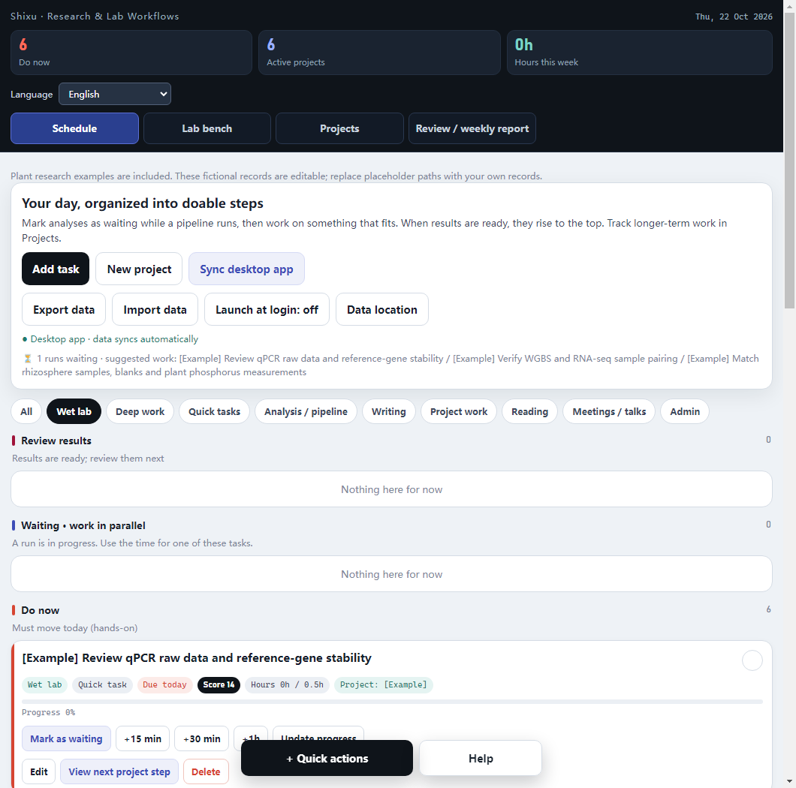
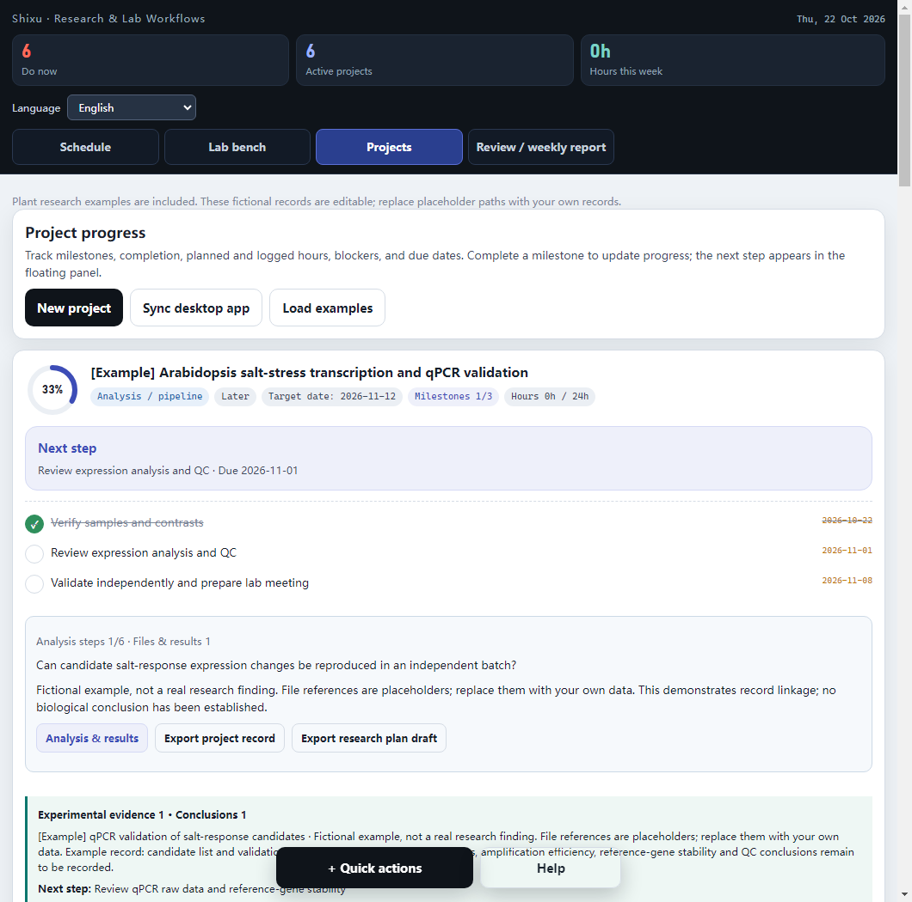
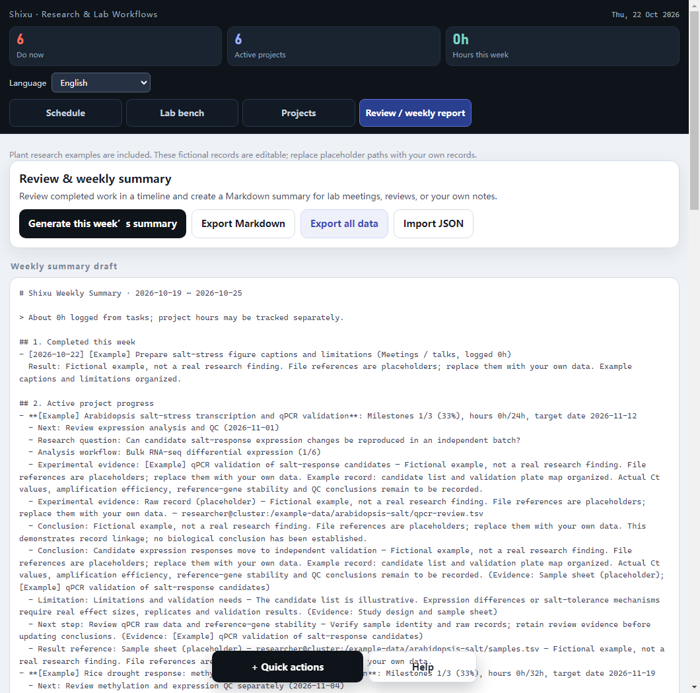
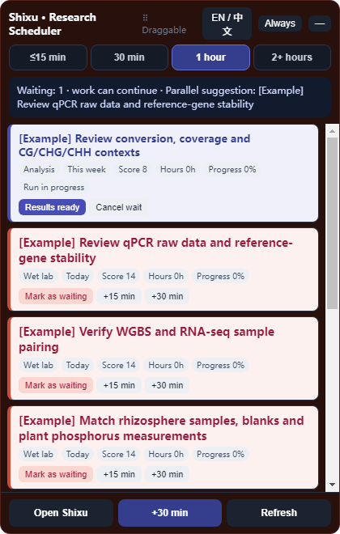

# Shixu Desktop

[](https://github.com/Einstein-life/shixu-desktop/releases/latest)
[](LICENSE)

**A local-first research workspace connecting wet-lab execution, bioinformatics planning and evidence-based project records.**

Shixu Desktop helps molecular biology, plant science and bioinformatics researchers keep the context around a study together over time:

> **Research question → Analysis workflow → Result evidence → Conclusion → Next step**

Research records stay on the computer. Shixu links project plans, experiment results, analysis steps and files without requiring a cloud account or moving original data.

## Download v1.2.1

| Platform | Installer |
| --- | --- |
| Windows 10/11, x64 | [Download Windows installer](https://github.com/Einstein-life/shixu-desktop/releases/download/v1.2.1/Shixu-Desktop-1.2.1-win-x64.exe) |
| macOS, Apple Silicon (M series) | [Download Apple Silicon DMG](https://github.com/Einstein-life/shixu-desktop/releases/download/v1.2.1/Shixu-Desktop-1.2.1-mac-arm64.dmg) |
| macOS, Intel | [Download Intel DMG](https://github.com/Einstein-life/shixu-desktop/releases/download/v1.2.1/Shixu-Desktop-1.2.1-mac-x64.dmg) |

The [release page](https://github.com/Einstein-life/shixu-desktop/releases/tag/v1.2.1) also includes macOS ZIP archives, SHA-256 checksums and validation reports.

**Signing status:** The Windows installer does not have a publisher certificate. The macOS apps use ad-hoc signatures; they are not Developer ID signed or notarized. Your operating system may display a publisher or security approval notice. Follow the system’s normal prompts; do not disable security protections.

## How it supports research

### Connect experiments and analyses

Create a project around a research question, select and edit an analysis scaffold, then record sample information, software and reference versions, parameters, QC decisions, findings and limitations. Link local files, web reports or remote paths to a project or an individual workflow step.

In **Lab bench → Record results**, connect an experiment to a research project. Its results and file references then appear with that project’s **Analysis & results**. Link evidence to a conclusion and create the next action from the same record. Project records, research-plan drafts and weekly summaries can reuse this information as Markdown.

### Keep work moving at the bench and desk

- Organize hands-on tasks, writing, analysis, meetings and waiting work in one daily schedule.
- Record experiments with preparation checklists, ordered hands-on/waiting steps, sample references and reagent lots.
- Run persistent timers, see due or overdue steps, and review work after resuming the app.
- Use dilution and master-mix calculators with values you enter yourself.
- Open the floating panel in always-visible or edge-docked mode; quick actions remain available alongside other desktop work.

A timer marks a planned handoff time. It does not certify that a step succeeded or passed QC. Notifications require the application to be running, and sleep may delay them.

### Plan common bioinformatics workflows

The project workspace includes 12 editable planning scaffolds covering bulk and single-cell RNA-seq, ATAC-seq, ChIP-seq/CUT&Tag, WGBS/RRBS, WGS/WES, small RNA, 16S/ITS, metagenomics, quantitative proteomics, metabolomics and multi-omics.

These scaffolds are for planning and documenting work. They do not install or run analysis pipelines; execute analyses in your validated computing environment.

## English-first onboarding

A new installation opens in English with an empty workspace. Click **Projects → Load examples** to add six fictional English plant studies, 18 linked tasks and six experiments:

- Arabidopsis salt-stress transcriptomics and qPCR validation
- Rice drought methylation–expression integration
- Tomato rhizosphere microbiota under low phosphorus
- Maize heat stress and pollen viability
- Wheat leaf-rust interaction and resistance candidates
- Soybean nodulation and rhizosphere communities

Example records are added only after you click **Load examples**. Loading can be repeated without creating duplicate examples and preserves edits. The interface can be switched to Chinese without translating user-authored study records.

All example results are fictional. File paths are placeholders. Replace them with your own records and your laboratory’s current approved SOPs before use.

## Screenshots

| Schedule (wet-lab filter) | Projects |
|:---:|:---:|
|  |  |

| Review and weekly report | Floating panel |
|:---:|:---:|
|  |  |

Screenshots show the English interface in v1.2.1 with fictional English plant research records. The Schedule view uses the Wet lab filter; project records, experimental results and file references are illustrative placeholders.

## Run from source

Requires Node.js 20 or later.

```bash
npm ci
npm run localize
npm start
```

Run checks and build installers with:

```bash
npm test
npm run check
npm run dist:win
npm run dist:mac
```

Build macOS packages on macOS. The build scripts write artifacts to `win/` and `mac/`.

## Local data and migration

Projects, tasks, experiment records and settings are saved locally. Shixu does not upload linked files. JSON import/export supports manual backup and transfer; desktop saves also keep a rotating backup. File references store paths rather than file contents, so linked files are not bundled into JSON or Markdown exports.

For compatibility, this release retains the existing `Shixu Desktop 2 Beta` data directory. Export a JSON backup before installing or upgrading. Existing records and saved language preferences are retained. Previous Chinese records remain in Chinese; loading the English examples adds records without translating or overwriting existing work.

## Validation and scope

Release v1.2.1 passed 58 automated tests and cross-platform packaging checks. Validation included Windows installer, startup and uninstall checks, packaged-source verification, macOS ad-hoc signature checks, mounted DMG verification, ZIP integrity and an Apple Silicon startup check using an isolated empty workspace. See [release validation](https://github.com/Einstein-life/shixu-desktop/blob/v1.2.1/docs/VALIDATION.md) and download `SHA256SUMS.txt` from the [release](https://github.com/Einstein-life/shixu-desktop/releases/tag/v1.2.1) to verify installer files.

These checks do not replace interactive acceptance on every operating system or device. Native Intel Mac startup has not been verified. Shixu complements laboratory SOPs, ELN/LIMS systems and workflow engines; it is not a regulated immutable audit trail and does not automatically execute bioinformatics pipelines.

## Citation and support

For research-software evaluations, cite the software version and report the operating system, processor architecture and workflow scaffolds used. Please open a [GitHub issue](https://github.com/Einstein-life/shixu-desktop/issues) to report a problem or suggest an improvement.

## License

MIT. See [LICENSE](LICENSE).
